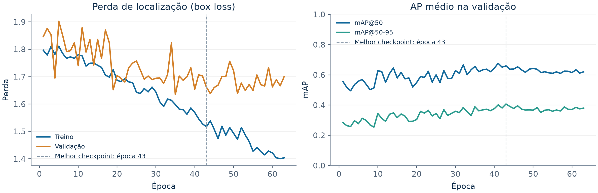
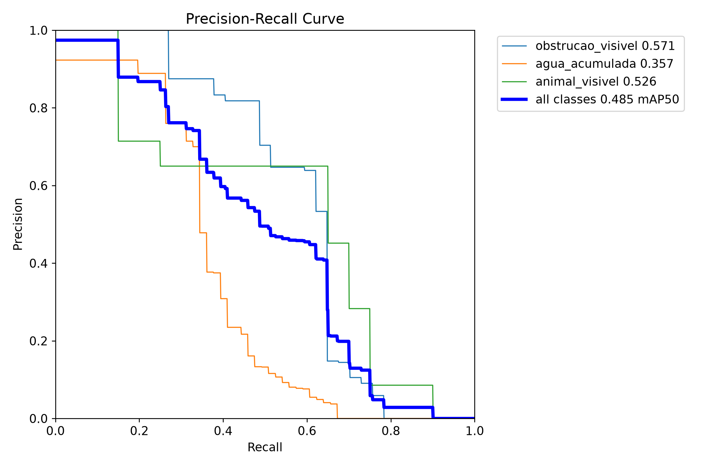
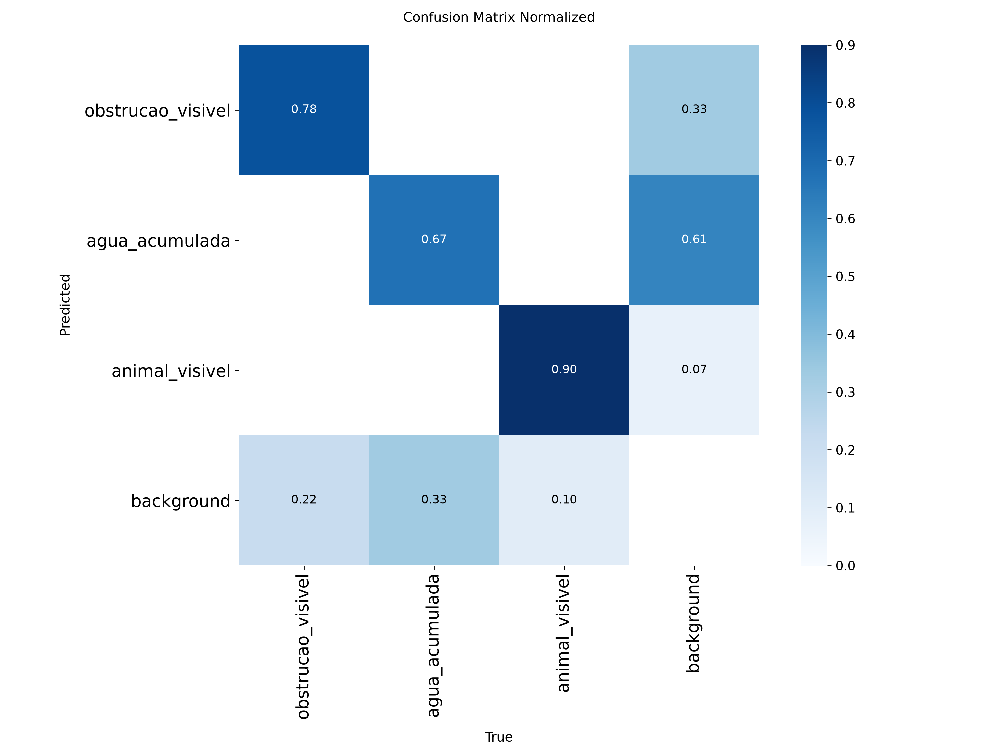
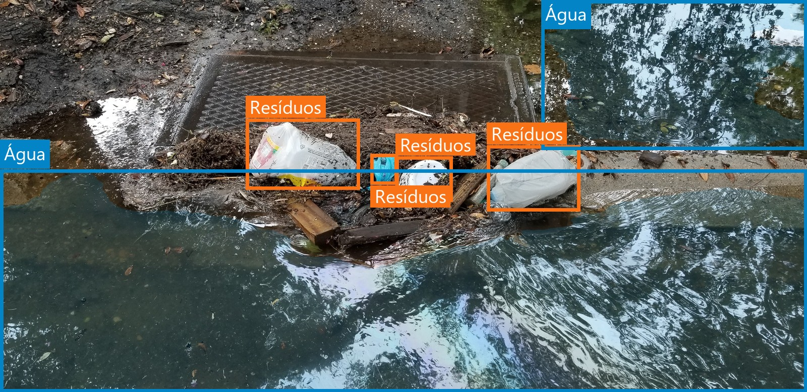
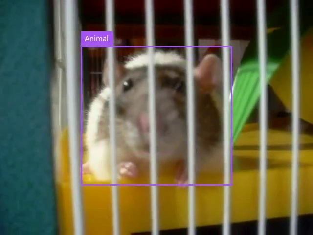
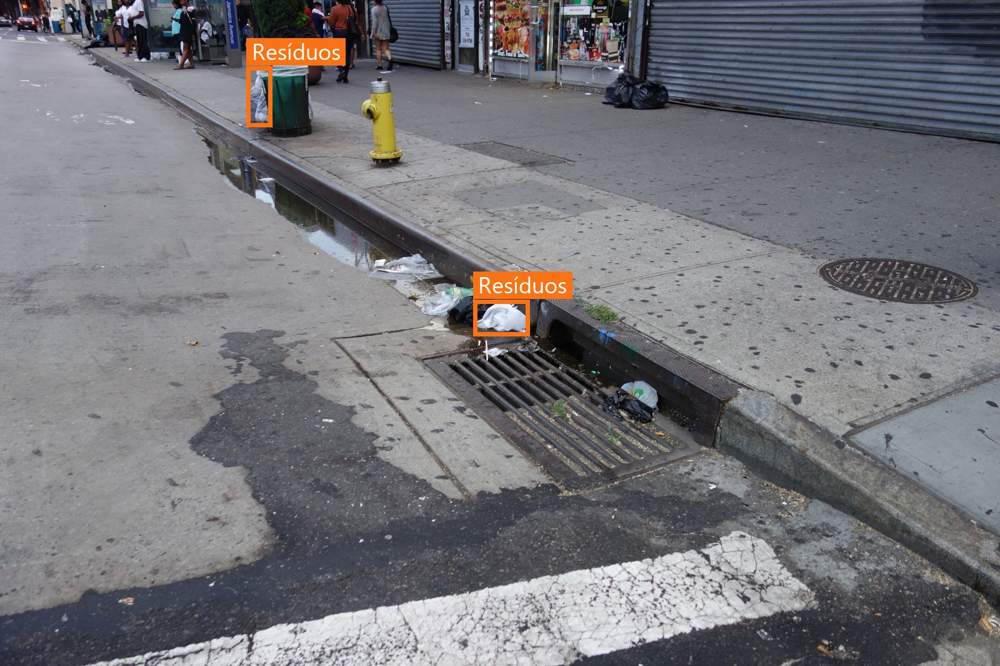
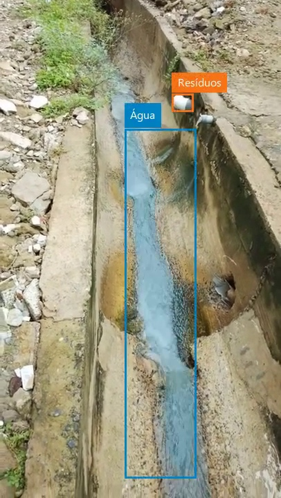
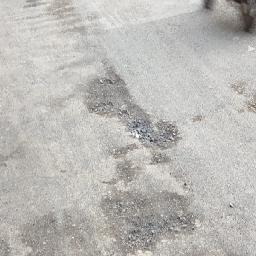

# DrenaVision

## Detecção de Anomalias Visuais em Sistemas de Drenagem

FIAP - Engenharia de Software

Global Solution 2026.2 - CitizenTech

Disciplina: Applied Computer Vision

Atividade: Enxergando o Mundo Real

Projeto: DrenaHub

Professores: Arnaldo Viana e Paulo Rodrigues

| Integrante | Registro acadêmico |
|---|---|
| Gabriel Machado Carrara Pimentel | RM99880 |
| Lourenzo Ramos | RM99951 |
| Vítor Hugo Rodrigues | RM97758 |

Relatório técnico da aplicação 0.5.0, com treinamento customizado YOLO v3 e avaliação do pipeline composto v4.

17 de novembro de 2026

Repositório: [Torugo0/drenahub-drenavision](https://github.com/Torugo0/drenahub-drenavision)

Entrega: código e documentação no GitHub público; vídeo demonstrativo, TXT com o link e este PDF como três anexos separados.

<!-- pagebreak -->

## 1. Resumo

O DrenaVision é um componente da DrenaHub destinado à triagem visual de pontos de drenagem por fotografias e vídeos. O protótipo procura resíduos, água visível e possíveis animais, apresentando marcações e avisos para apoiar a inspeção humana. Sua arquitetura combina um detector YOLO26n customizado, um segmentador SegFormer B1 para água, propostas Grounding DINO e verificação de recortes SigLIP 2. Apenas o YOLO recebeu treinamento customizado no projeto; os demais componentes utilizam pesos previamente treinados. O conjunto supervisionado contém 1.107 imagens de treinamento, 60 de validação e 60 de teste, provenientes de bases documentadas e quadros de adaptação. O treinamento executou 63 épocas, selecionando o checkpoint da época 43. No teste do YOLO isolado, foram obtidos precisão de 0,6512, recall de 0,5332, mAP@50 de 0,4845 e mAP@50-95 de 0,2574. A revisão da inferência foi congelada antes de avaliar quarenta novas fotografias da mesma fonte de resíduos. Nesse conjunto, o recall de caixas passou de 0,7167 para 0,8000, enquanto a precisão caiu de 0,7288 para 0,7059. Em regressões conhecidas, a identificação de presença animal aumentou, porém o acordo de localização das caixas piorou. Seis vídeos e duas fotografias concluíram a verificação funcional, incluindo decodificação de 1.388 quadros. FastAPI, Streamlit e SQLite integram análise, resultados estruturados, alertas visuais e histórico local. Permanecem perdas, falsos positivos, duplicidades e latência elevada. O sistema não mede profundidade, risco hidráulico ou impacto sanitário e não comprova prevenção de alagamentos. Os resultados caracterizam um protótipo acadêmico reproduzível, sujeito à confirmação humana e à validação adicional em condições operacionais.

**Palavras-chave:** visão computacional; drenagem; detecção de objetos; treinamento customizado; inspeção assistida.

## 2. Introdução

Resíduos próximos a grelhas, água em superfícies e animais em tubulações são sinais visuais que podem motivar a revisão de um ponto de drenagem. Fotografias e filmagens oferecem registros úteis, mas sua interpretação depende do contexto, da qualidade da captura e de uma pessoa responsável. Uma imagem não informa, por si só, a capacidade hidráulica de uma rede ou a causa de uma ocorrência.

A DrenaHub é o contexto de produto do módulo DrenaVision. O componente desenvolvido organiza o envio de registros, aplica visão computacional e apresenta evidências para síndicos, zeladores e equipes de manutenção. Sua contribuição ao CitizenTech está no apoio à inspeção e à organização da informação, sem substituir avaliação profissional ou demonstrar redução de alagamentos.

Este relatório descreve o código e as execuções existentes. Distingue o treinamento supervisionado do YOLO, a composição de modelos pré-treinados e as avaliações de diferentes versões. Métricas de validação, teste, regressão e demonstração são apresentadas separadamente. A estrutura segue os requisitos de Applied Computer Vision, nas páginas 43 e 44 do desafio FIAP [1].

<!-- pagebreak -->

## 3. Objetivo

Desenvolver e avaliar um componente de visão computacional para apoiar a inspeção de drenagem, mediante treinamento customizado de detector de resíduos, água e animais, complementado por modelos previamente treinados, disponibilizando marcações, alertas visuais e resultados estruturados em imagens e vídeos, com rastreabilidade experimental, limitações explícitas e confirmação humana das ocorrências.

## 4. Ferramentas e tecnologias

| Tecnologia e versão observada | Papel e justificativa na implementação |
|---|---|
| Python 3.12.10 | Linguagem comum à preparação dos dados, treinamento, inferência e aplicação. |
| PyTorch 2.14.1+cu130; torchvision 0.29.1+cu130 | Execução das redes e uso de CUDA no ambiente registrado. |
| Ultralytics 8.4.215; YOLO26n | Fine-tuning supervisionado, avaliação e detector leve com rastreamento opcional. |
| Transformers 4.57.3; safetensors 0.7.0 | Carregamento local dos especialistas SegFormer, Grounding DINO e SigLIP 2. |
| OpenCV 4.14.0.94; imageio-ffmpeg 0.8.1 | Leitura de quadros, desenho de marcações e exportação de MP4 H.264 reproduzível no navegador. |
| FastAPI 0.163.1; Pydantic 2.14.3 | API HTTP e validação dos contratos de entrada e saída. |
| Streamlit 1.67.0; HTTPX 0.28.1 | Interface única para fotos/vídeos e comunicação HTTP com a API. |
| SQLite | Histórico local e associação entre eventos e evidências derivadas; SQL parametrizado e modo WAL. |
| NumPy 2.2.6; Pillow 12.0.0 | Manipulação de arrays, imagens e dimensões. |
| faster-coco-eval 1.8.0; pytest; Ruff | Apoio à avaliação, testes automatizados e análise estática. |

As versões de execução foram conferidas nos metadados do ambiente e nos manifestos de treinamento. O arquivo `pyproject.toml` fixa as dependências da aplicação. Os dois componentes de objetos e o segmentador de água são pré-treinados: sua inclusão não constitui um novo treinamento customizado [2-6].

### 4.1 Ambiente e alcance

O treinamento registrado foi executado em Windows 11 com CUDA e GPU NVIDIA GeForce RTX 4060 de aproximadamente 8 GB. As medidas de latência do produto referem-se a essa máquina; não são uma promessa para CPU ou outro equipamento. A inferência é local. O download de modelos é uma preparação separada, com revisão e hashes fixados; a análise de um arquivo não chama um serviço externo de IA.

<!-- pagebreak -->

## 5. Metodologia passo a passo

### 5.1 Etapa 1 - Dados, classes e proveniência

O dataset ativo do YOLO é definido por `dados/dataset.yaml`, que aponta para `dados/processed/drenavision_v3_clean`. Os identificadores são estáveis: 0 = `obstrucao_visivel`, 1 = `agua_acumulada` e 2 = `animal_visivel`. Na interface, esses nomes são apresentados como resíduos, água e possível animal. A presença de resíduos não demonstra obstrução hidráulica; a classe de água inclui superfície parada ou em movimento, sem estimativa de profundidade.

| Origem | Treino | Validação | Teste | Anotação e licença adotada |
|---|---:|---:|---:|---|
| CLICK Trash v2 | 250 | 20 | 20 | Caixas nativas de resíduos; CC BY 4.0 [7]. |
| Stagnant Water and Wet Surface v4 | 500 | 20 | 20 | Classe de água remapeada; CC BY 4.0 [8]. |
| iRodent 1.0 | 333 | 20 | 20 | Envelopes de pontos visíveis; conteúdo tratado como CC BY-NC 4.0 [9]. |
| Quadros e recortes revisados do domínio | 24 | 0 | 0 | Quatro fontes de vídeo, com licenças CC BY ou CC BY-SA por arquivo. |
| **Total de imagens** | **1.107** | **60** | **60** | **1.227 imagens no conjunto supervisionado.** |

Os 24 itens de adaptação vêm de Roedor atrás da grade, Roedor junto a resíduos, Água transbordando e Canal de Alajo. Seus clipes de origem são exemplos funcionais conhecidos e não testes independentes. O catálogo de demonstração contém seis vídeos e duas fotos, com autor, URL, licença, modificações e SHA-256 em `dados/examples/sources.json`.

| Split | Caixas de resíduos | Caixas de água | Caixas de animal |
|---|---:|---:|---:|
| Treino | 498 | 1.453 | 344 |
| Validação | 40 | 59 | 20 |
| Teste | 37 | 61 | 20 |

As caixas CLICK podem representar um objeto ou um grupo. No iRodent, envelopes de pontos visíveis podem cobrir apenas cabeça ou parte do tronco; não são referências certificadas de corpo inteiro. Para água, caixas conectadas foram agrupadas em envelopes, que podem conter áreas secas. Essas diferenças afetam a comparação por IoU.

Os dados completos e pesos permanecem fora do Git. Manifestos registram identidade, divisão, origem e hashes; verificações de identidade, grupos de origem e pHash reduzem vazamento local conhecido. Isso não permite auditar possíveis sobreposições com o pré-treinamento dos modelos externos.

<!-- pagebreak -->

### 5.2 Etapa 2 - Preparação e validação dos rótulos

As fontes são convertidas para o formato YOLO, com IDs de classe consistentes e coordenadas normalizadas. Imagens e rótulos são validados quanto a existência, dimensões, limites e área das caixas. A preparação v3 corrigiu negativos de água inadequados e agrupou somente caixas de água que se tocam ou se sobrepõem, sem preencher lacunas positivas artificialmente.

O relatório de preparação registra 1.107/60/60 pares imagem-rótulo, zero grupos de duplicatas exatas e ausência de erros estruturais. Isso valida o formato, não garante a completude semântica das anotações. A auditoria posterior identificou apenas cinco negativos de treino claramente revisados; o sexto nominal contém conteúdo de resíduo incerto. Essa baixa diversidade negativa é uma limitação relevante.

No treinamento, a resolução configurada foi 640 pixels. Os argumentos efetivos preservam aumentação HSV (`h=0,015`, `s=0,7`, `v=0,4`), translação 0,1, escala 0,5, espelhamento horizontal 0,5 e mosaic 1,0. O parâmetro `close_mosaic=10` previa desativar o mosaic nas dez últimas das 80 épocas planejadas; o treino parou na 63 e não alcançou esse fechamento programado. Mixup e cutmix estavam em zero. As configurações estão em `args.yaml`; transformações não são novas cenas independentes.

### 5.3 Etapa 3 - Treinamento customizado comprovado

O YOLO26n v3 foi ajustado a partir de `best_v2.pt`, uma versão anterior treinada a partir de pesos oficiais pré-treinados. A invocação válida v3 iniciou a partir desse checkpoint preservado; uma tentativa anterior interrompida por rótulos negativos inadequados não foi promovida.

| Parâmetro ou evidência | Valor registrado |
|---|---|
| Meta / épocas executadas | 80 / 63, com parada antecipada |
| Época do melhor checkpoint | 43, segundo o CSV e a seleção por validação |
| Entrada / batch / seed | 640 pixels / 12 / 42 |
| Paciência / workers | 20 / 2 |
| Otimizador | `auto`; nome efetivo não preservado separadamente, portanto não inferido |
| Determinismo / AMP / cache | true / true / false |
| Dispositivo | CUDA, GPU 0 |
| Tempo da invocação no manifesto | 1.083,780 s, aproximadamente 18min04s |
| Tempo acumulado da última linha CSV | 1.068,950 s; escopo distinto do tempo de parede |
| Modelo usado pelo produto | `resultados/local/models/best.pt` |

O hash do checkpoint inicial difere do final, e os registros declaram `weights_changed_from_base: true`. Manifesto, CSV de 63 épocas e checkpoint sustentam que houve treinamento customizado. O DINO, o SigLIP 2 e o SegFormer não foram treinados pela equipe nesta revisão. Seus pesos fixos complementam a inferência, não substituem a evidência do fine-tuning.

<!-- pagebreak -->

### 5.4 Etapa 4 - Protocolo de avaliação

Foram separadas duas perguntas experimentais: a qualidade do detector YOLO treinado e o comportamento do produto composto. O mAP do YOLO isolado não é atribuído à combinação de redes. Na comparação atual, “baseline” significa produto 0.4 e “candidato” significa produto 0.5, ambos avaliados nos mesmos arquivos de cada coorte.

| Coorte | Uso real | Limite da interpretação |
|---|---|---|
| Validação de 60 imagens | Seleção dos parâmetros do YOLO e calibração posterior dos especialistas; 20 imagens de cada fonte. | Desenvolvimento, não teste independente nem acurácia geral. |
| Teste supervisionado de 60 imagens | Métricas de precisão, recall e AP do YOLO isolado; depois regressão conhecida do produto. | A revisão 0.5 já conhece essa coorte; não é um novo teste cego. |
| Conjunto adicional de 119 imagens | Regressão sobre 69 positivas de animal, 40 positivas de água e dez superfícies negativas de água. | Dados já examinados em versões anteriores; ausência de rótulos de outras classes é apenas proxy negativo. |
| CLICK-test reservado de 40 imagens | Avaliação após congelar o perfil 0.5, com 60 caixas de resíduos. | Mesma fonte/câmera conhecida; 40 positivas de resíduos, sem negativas dessa classe ou positivas de animal. |
| Fotos do usuário e catálogo | Reprodução de problemas e verificação funcional de API/interface. | Fotos do usuário ficam fora de treino/calibração; quatro fontes do catálogo forneceram adaptação somente ao treino. Não compõem uma taxa geral de acerto. |

O perfil 0.5 foi congelado antes das previsões nas quarenta imagens novas. A seleção de resíduos maximizou F2 de caixas na validação, priorizando cobertura, com precisão mínima 0,70 e limite adicional de falsos alertas nas negativas revisadas. Para animal, foi usado F1 de presença e critérios de desempate que favorecem menos falsos positivos. Nenhum parâmetro foi retunado após o holdout.

Precisão é TP/(TP+FP); recall é TP/(TP+FN). F1 equilibra precisão e recall; F2 dá maior peso ao recall. IoU é a razão entre interseção e união de duas caixas; o casamento de caixas do produto usa IoU mínimo 0,50. AP resume a curva precisão-recall de uma classe; mAP@50 usa IoU 0,50 e mAP@50-95 combina limiares de 0,50 a 0,95.

Presença por imagem responde se houve ao menos uma marcação da classe, sem garantir enquadramento correto. Casamentos por caixa avaliam localização. Desconhecidos são excluídos quando a presença não pode ser estabelecida. As revisões visuais assistidas e referências nativas não equivalem a uma anotação humana independente e completa.

<!-- pagebreak -->

### 5.5 Etapa 5 - Inferência de imagens e vídeos

O YOLO recebe a imagem e fornece classes, caixas e confiança. No produto 0.5, Grounding DINO Tiny propõe resíduos e roedores a partir de um vocabulário fixo, comum a todas as entradas. Os resultados dependem dos pixels; nomes de arquivos ou caixas desenhadas manualmente não são usados para fabricar detecções.

SigLIP 2 compara o recorte proposto com descrições positivas e negativas fixas. A margem é a maior similaridade cosseno positiva menos a maior negativa: não é uma probabilidade calibrada de risco. O contexto de 10% em torno do recorte serve somente à classificação; não expande a caixa de saída. Propostas de animal substituem as do YOLO; propostas de resíduos complementam as existentes, com supressão de sobreposição por classe. Parte das caixas legadas de resíduos do YOLO permanece sem essa verificação adicional.

O SegFormer B1 identifica seis categorias de superfície de água da base ADE. Pixels aceitos exigem confiança de pelo menos 0,95 e componentes com área real de pelo menos 5% da imagem. Máscaras indicam pixels previstos; seus retângulos podem incluir concreto ou outras áreas no interior do envelope. Não se estima água estagnada, profundidade, fluxo ou risco hidráulico.

| Configuração congelada | Valor |
|---|---|
| Confiança YOLO resíduos / animal | 0,35 / 0,60 |
| Confiança DINO resíduos / animal / texto | 0,30 / 0,25 / 0,20 |
| Margem SigLIP 2 resíduos / animal | 0,04 / 0,08 |
| Redimensionamento DINO | lado curto 640; lado longo limitado a 1.024 |
| IoU do YOLO / DINO e fusão por classe | 0,45 / 0,50 |
| Água em vídeo | confirmação por sequência de pelo menos 0,5 segundo |

Nos vídeos, cada quadro original decodificado recebe nova inferência neural dos especialistas. O rastreador ByteTrack é opcional para o pequeno YOLO; as propostas DINO não recebem IDs persistentes. Contagens técnicas usam IDs quando disponíveis e picos simultâneos como alternativa, sem garantir número de objetos físicos distintos.

A confirmação temporal de água exige uma sequência de `ceil(FPS × 0,5)` quadros. Sem essa sequência, as propostas brutas ficam preservadas no JSON, mas são suprimidas da exibição do clipe e o resultado é redesenhado a partir dos quadros originais. O arquivo final usa MP4 H.264 e início rápido, com download e reprodução parcial HTTP.

### 5.6 Etapa 6 - Integração do MVP

A interface envia fotos e vídeos por HTTP à FastAPI. A API mantém os modelos pesados carregados uma vez; o processamento de vídeo reutiliza essas instâncias e cria apenas um YOLO leve independente para rastreamento. A saída combina mídia anotada, JSON e um evento SQLite. A integração implementada é o módulo local da DrenaHub com contrato de API; não há evidência de uma plataforma externa conectada em produção.

<!-- pagebreak -->

## 6. Resultados experimentais

### 6.1 Detector YOLO treinado: teste de 60 imagens

Os valores abaixo vêm de `candidate_master_test_metrics.json` e `master_map_comparison.json`, em `resultados/metrics/v3`. A execução de teste usou resolução 640, batch 8, CPU, confiança inicial 0,001 e IoU de pós-processamento 0,60. Precisão e recall são reportados no ponto operacional escolhido pela Ultralytics; AP integra a curva de confiança. As referências são as caixas v3, com suas limitações.

| Classe | Precisão | Recall | AP@50 | AP@50-95 |
|---|---:|---:|---:|---:|
| Resíduos | 0,6051 | 0,6216 | 0,5710 | 0,4089 |
| Água | 0,7041 | 0,3279 | 0,3565 | 0,1569 |
| Animal | 0,6444 | 0,6500 | 0,5260 | 0,2065 |
| **Agregado das três classes** | **0,6512** | **0,5332** | **0,4845** | **0,2574** |

A linha agregada apresenta mAP, a média entre as três classes. Na comparação do YOLO v2 e v3 nas mesmas referências, o mAP@50 agregado passou de 0,3349 para 0,4845; mAP@50-95 passou de 0,1748 para 0,2574. O AP50 de resíduos caiu de 0,6233 para 0,5710, enquanto o AP50-95 dessa classe aumentou. A melhora agregada não representa ganho em toda classe e todo limiar.



*Figura 1. Curvas produzidas a partir das 63 linhas de `training_results.csv`: perdas de caixa no treino/validação e mAP de validação. A linha vertical indica a época 43 selecionada. Fonte: execução do projeto. As curvas são de desenvolvimento, não do teste nem do produto composto.*

O manifesto registra validação final do melhor checkpoint com mAP@50 de 0,6597 e mAP@50-95 de 0,4071. Esses valores de validação diferem do teste acima e não devem ser apresentados como desempenho em dados não utilizados no ajuste. A pequena diferença para o CSV arredondado da época 43 decorre da validação final registrada separadamente.

<!-- pagebreak -->

### 6.2 Curva precisão-recall e matriz de confusão



*Figura 2. Curva precisão-recall real do YOLO v3 no teste de 60 imagens. AP50: resíduos 0,571; água 0,357; animal 0,526; média 0,485. Fonte: saída Ultralytics de `candidate_v3_on_water_regions_v3`. Não descreve o pipeline composto 0.5.*



*Figura 3. Matriz normalizada da mesma execução de teste: linhas são previsões, colunas são referências e background representa fundo/perdas. A matriz usa confiança 0,001 e casamento IoU 0,50; a tabela de precisão/recall usa outro ponto de confiança escolhido pela biblioteca. Por isso, suas diagonais não são os recalls da tabela. Fonte: saída real do projeto.*

<!-- pagebreak -->

### 6.3 Produto 0.5: quarenta imagens reservadas

As identidades e a revisão foram seladas antes das previsões, e o perfil 0.5 foi congelado antes da avaliação. Não há sobreposição local por hash ou pHash até quatro. A fonte CLICK permanece conhecida; o holdout não comprova generalização para outros ambientes.

| Medida em CLICK40 | Produto 0.4 | Produto 0.5 |
|---|---:|---:|
| Imagens positivas de resíduos sinalizadas | 38/40 | 39/40 |
| Caixas correspondentes (TP), IoU 0,50 | 43 | 48 |
| Previsões sem correspondência (FP) | 16 | 20 |
| Caixas de referência perdidas (FN) | 17 | 12 |
| Precisão de caixas | 0,7288 | 0,7059 |
| Recall de caixas | 0,7167 | 0,8000 |
| F1 de caixas | 0,7227 | 0,7500 |
| Mediana de inferência por imagem | 614,6 ms | 965,2 ms |

Existem sessenta caixas nativas de resíduos nas quarenta imagens. A cobertura aumentou com mais falsos positivos e maior custo de execução. Não há imagens negativas de resíduos nessa coorte; portanto, a taxa de falso alerta dessa classe não pode ser estimada nela. Trinta e oito imagens foram revisadas como negativas de animal e duas ficaram incertas: ambos os perfis tiveram zero alertas nas 38 negativas. Não existem positivos de animal para medir recall nessa coorte.

### 6.4 Regressões conhecidas: test60 e extra119

| Medida de animal | Produto 0.4 | Produto 0.5 |
|---|---:|---:|
| Presença nas 20 positivas de test60 | 14/20 | 19/20 |
| Falsos alertas nas 40 negativas por proxy de test60 | 0/40 | 0/40 |
| F1 de caixas de animal em test60 | 0,4706 | 0,3913 |
| Presença nas 69 positivas de extra119 | 46/69 | 63/69 |
| Falsos alertas nas 50 negativas por proxy de extra119 | 0/50 | 0/50 |
| F1 de caixas de animal em extra119 | 0,6207 | 0,6014 |

A identificação de presença melhorou, mas a concordância de localização piorou nas duas coortes. Existem duplicidades e caixas amplas; referências de pose parciais também afetam o casamento, sem justificar considerar todos os falsos positivos como erro de rótulo. Em resíduos de test60, TP/FP/FN passaram de 23/14/14 para 25/20/12, com F1 de 0,6216 para 0,6098.

O componente de água teve saídas iguais nos 219 pares, dentro da tolerância registrada: paridade, não nova acurácia. No extra119, manteve presença em 33/40 positivas e dois falsos alertas em dez negativos revisados. Ausência de rótulo de água nas outras fontes é somente proxy negativo. Não foi medido mAP completo do produto composto.

<!-- pagebreak -->

### 6.5 Vídeos, API, interface e latência

Todos os seis vídeos e duas fotos do catálogo concluíram pela API 0.5. Foram verificados eventos persistidos, hashes, dimensões, FPS, duração, H.264, início rápido, respostas parciais HTTP 206 e decodificação integral dos 1.388 quadros. Essa é uma verificação funcional, não uma anotação de acerto por quadro.

| Vídeo | Quadros | Com animal | Com água exibida | Com resíduos | Tempo de processamento |
|---|---:|---:|---:|---:|---:|
| Roedor junto a resíduos | 240 | 144 | 0 | 227 | 90,81 s |
| Roedor atrás da grade | 220 | 220 | 0 | 0 | 75,14 s |
| Roedor na rua, difícil | 240 | 1 incerto | 0 | 64 | 82,60 s |
| Drenagem na chuva | 240 | 0 | 224 | 84 | 88,80 s |
| Canal de Alajo | 208 | 0 | 208 | 0 | 67,14 s |
| Sarjeta de Alajo | 240 | 0 | 139 | 40 | 79,89 s |

“Com animal/água/resíduos” é o número de quadros que receberam uma proposta exibida, sem equivalência a objetos distintos ou acertos confirmados. A proposta isolada do roedor na rua continua visualmente incerta. Em Hanói, as propostas de animal caíram de 187/240 na versão anterior para 144/240: não se estabelece melhora temporal geral.

Os clipes de 10,4 a 12 segundos exigiram aproximadamente 67 a 91 segundos. A solução demonstrada processa arquivos; não foi validada para inferência em tempo real. A interface informa a espera e oferece download e reprodução do arquivo anotado.

A verificação real no navegador registrou o envio das duas fotografias do usuário, cartões/alertas e reprodução do clipe de Hanói até 12/12 segundos, sem erro de mídia. Nos demais clipes, o transporte e a decodificação foram verificados integralmente; não se afirma que todos foram vistos integralmente nessa rodada de navegador.

### 6.6 Verificação do software e auditoria documental

A checagem final da entrega executou a suíte completa: 239 testes aprovados em 32,21 segundos, com um aviso de depreciação da dependência de teste. O registro JUnit está em `resultados/local/report_audit/pytest_final.xml`. Antes, o perfil ativo já registrava 236 testes e três do cliente HTTP separados; esse registro histórico foi preservado. Foram analisados por AST 108 arquivos Python anteriores ao gerador do relatório, incluindo 37 arquivos de teste, e o Ruff passou. A geração documental não repetiu treinamento ou inferência das redes reais. Definições de funções não são confundidas com testes parametrizados executados.

Nesta revisão, foram conferidos dados, contratos, fontes, logs, checkpoints, métricas, figuras, API saudável, guias e licenças. Não foi identificado código-fonte sem função comprovada. Configurações e métricas históricas foram preservadas para reprodução; instruções obsoletas foram corrigidas. Caches locais de bytecode permaneceram ignorados pelo Git após bloqueio automático de sua remoção. Isso não altera a distribuição do código.

<!-- pagebreak -->

### 6.7 Exemplos reais: resíduos, água e animal



*Figura 4. Quatro marcações de resíduos e duas regiões de água do produto 0.5, sem inferência de profundidade. Foto de Bart Everson, “Storm Drain Clogged - Mid-City New Orleans”, CC BY 2.0 [13]. Adaptação: redimensionamento e sobreposição das previsões reais. Exemplo manual conhecido, fora dos splits supervisionados e sem caixas humanas completas de referência.*



*Figura 5. Quadro 110, a 5,50 s do clipe a 20 FPS, com caixa de animal produzida pelo produto 0.5. Fonte: Ykmyks, “Rat.ogv”, CC BY-SA 4.0 [14]. Adaptação: trecho convertido e extração do quadro já anotado. A fonte forneceu itens de adaptação de treino; é demonstração conhecida, não evidência independente de generalização.*

As figuras são saídas de execuções reais, selecionadas para explicar o produto. Não substituem as métricas sobre as coortes completas. Os arquivos de resposta, hashes e papéis de avaliação estão registrados no manifesto das figuras e no relatório de verificação funcional.

<!-- pagebreak -->

### 6.8 Casos reais de erro e ausência de marcação



*Figura 6. O produto marca duas regiões de resíduos, mas deixa outros resíduos e água rasa visíveis sem marcação. Fonte: Tdorante10, “Sutphin Bl Jamaica Av td (2019-08-18) 14.jpg”, CC BY-SA 4.0 [15]. Adaptação: redimensionamento e previsões reais. Regressão manual; não há uma contagem humana completa de todos os objetos.*



*Figura 7. Quadro 239, a 11,95 s: além de água, um cotovelo de PVC instalado recebe rótulo de resíduo. Fonte: Ibnali1, “Gutter to the Alajo Storm Drain.webm”, CC BY-SA 4.0 [16]. Adaptação: extração do vídeo anotado. O falso positivo é mantido como limite do protótipo, sem correção manual da caixa.*

<!-- pagebreak -->

### 6.9 Entrada sem marcações: interpretação conservadora



*Figura 8. Superfície úmida revisada como negativa de água livre; o produto 0.5 retornou uma lista vazia de detecções. Fonte: Kailas Patil e Sonali Bhutad, dataset Mendeley v4, CC BY 4.0 [8]. Origem: `Outdoor/Wet surface/Top view/image707.jpeg`, identidade `water_extra_49e2d3853707e266`. A imagem foi renomeada na preparação; não há caixas a sobrepor.*

Este caso mostra o comportamento “sem marcação”, não um certificado de ausência de todas as anomalias ou de segurança. A revisão negativa é específica de água livre. Não existe neste material uma certificação independente de cena sem qualquer uma das três classes, e essa exigência não foi simulada.

A interface diferencia a recomendação de revisão da ausência de detecção, mantendo uma mensagem de que objetos podem passar despercebidos. A decisão final de inspecionar depende da pessoa responsável e de informações locais adicionais.

### 6.10 Rastreabilidade das figuras

Todas as figuras de detecção preservam as coordenadas calculadas pelo modelo. As extrações de vídeo usam MP4s processados na verificação funcional 0.5. Os gráficos de AP e matriz provêm do teste YOLO v3 correto; gráficos históricos de outras versões não foram apresentados como atuais.

`assets/manifesto_figuras.json` registra autor, licença, URL de origem, modificações, execução de referência e hashes. O manifesto de geração complementa a identidade dos demais assets. Fotos pessoais de teste cuja origem não estava documentada não foram incorporadas ao PDF.

<!-- pagebreak -->

## 7. Arquitetura e integração

<!-- architecture -->

*Figura 9. Fluxo implementado no MVP local. A composição neural ocorre na API, antes da criação da evidência e do evento. Fonte: elaboração a partir de `runtime.py`, `video.py`, `api/main.py`, `storage.py` e `streamlit_app.py`.*

### 7.1 Responsabilidades e contrato

A interface Streamlit reúne upload, exemplos e foto da câmera. A FastAPI valida arquivo e conteúdo, controla acesso concorrente à inferência e retorna um evento estruturado. O SQLite associa UUID, ponto opcional, data UTC, perfil, resultados e localização da evidência. As evidências são JPEG anotado ou MP4 e JSON; uploads temporários de vídeo são removidos ao final, inclusive em falha. Falhas de persistência removem apenas os artefatos novos da operação.

Cada detecção contém `class_id`, `class_name`, `confidence`, `bounding_box`, `bounding_box_format`, `track_id`, `frame_index` e `timestamp_seconds`. A caixa é `xyxy_pixels` na imagem original: canto superior esquerdo e inferior direito. Campos de rastreamento e tempo podem ser nulos em fotos.

O evento inclui `event_id`, `point_id`, `timestamp`, `input_type`, `model_version`, `detections`, `inspection_recommended`, `status`, `evidence_uri`, `inference_ms` e `disclaimer`. O estado é `sem_deteccao` ou `revisao_recomendada`; embora o schema comporte `revisado`, não existe endpoint de alteração de revisão humana. Confianças de arquiteturas distintas não são probabilidades comparáveis de risco.

<!-- pagebreak -->

### 7.2 Endpoints públicos observados

| Método e rota | Finalidade |
|---|---|
| GET `/health` | Saúde da API, modelo carregado, banco e versão. |
| GET `/vision/classes` | Classes e seus nomes de apresentação. |
| POST `/vision/predict` | Receber foto, analisar, salvar evidência e evento. |
| POST `/vision/predict/video` | Receber vídeo e produzir MP4 anotado, manifesto e evento. |
| GET `/vision/videos/{event_id}` | Baixar/reproduzir MP4 com suporte a Range 206. |
| GET `/vision/events` | Consultar histórico com paginação e filtros. |
| GET `/vision/events/{event_id}` | Consultar um evento. |
| GET `/vision/evidence/{event_id}` | Recuperar JPEG da foto ou JSON de evidência do vídeo. |

### 7.3 Exemplo de retorno real

O trecho abaixo foi extraído da análise de `bueiro_agua.jpg` usada na Figura 4. Para legibilidade, mostra somente uma das seis detecções, com campos de identificação e outros detalhes omitidos. Os números e coordenadas não foram fabricados; o retorno completo está em `bueiro_agua.response.json`, no diretório local da verificação funcional.

```json
{
  "input_type": "image",
  "model_version": "pipeline-4c5c993223219929",
  "inspection_recommended": true,
  "status": "revisao_recomendada",
  "inference_ms": 470.26390000064566,
  "detections": [
    {
      "class_id": 0,
      "class_name": "obstrucao_visivel",
      "confidence": 0.4522443413734436,
      "bounding_box": [
        784.50146484375, 310.5698547363281,
        897.325927734375, 400.88336181640625
      ],
      "bounding_box_format": "xyxy_pixels"
    }
  ]
}
```

### 7.4 Operação e limites de integração

Fotos JPEG/PNG têm limite configurado de 12 MiB e quarenta milhões de pixels. Vídeos MP4, MOV, AVI e MKV exigem extensão e MIME compatíveis, limite de 500 MiB e upload em blocos de 1 MiB. Há respostas distintas para formato inválido, limite excedido, modelo indisponível e evidência inexistente. A reprodução foi testada no formato final H.264, não garantida para qualquer codec original no navegador.

Os alertas implementados são visuais, na própria tela. Não há envio automático por WhatsApp, email ou SMS, criação de ordem de serviço, conexão municipal ou monitoramento contínuo por sensores. A DrenaHub pode consumir o contrato HTTP, mas uma integração externa de produção ainda precisaria ser implementada e avaliada.

<!-- pagebreak -->

## 8. Discussão dos resultados

O treinamento customizado melhorou o mAP agregado do YOLO nas referências v3, mas resíduos perderam AP50 e água teve recall baixo no detector isolado. A inclusão do segmentador foi uma resposta ao limite observado para superfícies de água. Na revisão 0.5, o detector de vocabulário aberto e a verificação de recortes aumentaram a cobertura de presença animal e de caixas de resíduos, com mais custo e erros de localização.

É necessário separar quatro fatores. Primeiro, iluminação, tamanho do alvo, oclusão e fundo afetam o sinal visual: um roedor entre vegetação é mais difícil que um animal em close. Segundo, as fontes não representam integralmente o ambiente de drenagem pretendido. Terceiro, há poucos negativos revisados de treino. Quarto, os rótulos misturam objetos individuais, grupos, regiões de água e envelopes de pose parcial. Essas condições limitam tanto o aprendizado quanto a interpretação das métricas.

O produto ainda confunde elementos funcionais, como PVC e lixeiras fixas, com resíduos, deixa água rasa sem marcação e produz caixas sobrepostas. A redução de falsos alertas por supressão adicional foi investigada offline, mas não aplicada porque removia verdadeiros positivos em outras regressões. Manter o candidato congelado permite revelar esse conflito, em vez de corrigir somente exemplos conhecidos.

A presença de água não caracteriza profundidade, estagnação, doença, risco elétrico ou insuficiência hidráulica. A identificação de um possível animal não confirma espécie, infestação ou risco sanitário. As sugestões na tela encaminham uma verificação humana. A ausência de marcação também pode decorrer de uma falha do detector.

Os vídeos conhecidos e suas figuras são demonstrações de funcionamento, com algumas fontes já usadas na adaptação. Não comprovam generalização, rastreamento perfeito ou contagem de indivíduos. A revisão piorou a cobertura temporal de animal em Hanói e não resolveu o caso da rua. A latência medida impede alegar tempo real no perfil atual.

O código usa AGPL-3.0-only; as imagens têm licenças próprias. DINO e SigLIP 2 usam Apache-2.0. O conteúdo iRodent é tratado conservadoramente como não comercial e o SegFormer possui licença NVIDIA para pesquisa e avaliação não comercial. Essas condições são compatíveis com o recorte acadêmico adotado, sem conceder autorização implícita para explorar comercialmente todo o conjunto [6-9].

## 9. Conclusão

Foi implementado um módulo local reproduzível que prepara dados, comprova fine-tuning customizado do YOLO, avalia resultados e analisa fotos/vídeos por API e interface. Os artefatos demonstram treinamento, alteração de pesos, execução nos conjuntos definidos e geração de marcações reais com histórico e download.

A composição 0.5 recuperou mais presenças animais nas regressões e mais caixas de resíduos no holdout da mesma fonte, com piora de precisão ou localização em parte das medidas. Esses ganhos e perdas caracterizam um protótipo acadêmico de inspeção assistida, não um sistema operacional certificado.

Uma implantação real exigiria coleta representativa em drenagem, mais negativos, anotações completas revisadas por pessoas, validação externa por local e período, revisão de licenças, melhoria de localização e desempenho e um fluxo operacional de confirmação. A contribuição comprovada à DrenaHub é organizar sinais visuais e evidências para a avaliação humana, sem comprovar prevenção de alagamentos.

<!-- pagebreak -->

## 10. Referências

[1] FIAP. Desafio Global Solution 2026.2 - CitizenTech, Engenharia de Software, 4º ano. Applied Computer Vision: Enxergando o Mundo Real, p. 43-44. PDF fornecido à equipe. Consulta em 17 nov. 2026.

[2] ULTRALYTICS. YOLO26 e treinamento de modelos. Documentação oficial. [Arquitetura YOLO26](https://docs.ultralytics.com/models/yolo26/) e [modo de treinamento](https://docs.ultralytics.com/modes/train/). Consulta em 17 nov. 2026.

[3] IDEA RESEARCH. Grounding DINO Tiny. Model card oficial, revisão `a2bb814dd30d776dcf7e30523b00659f4f141c71`. [Modelo e documentação](https://huggingface.co/IDEA-Research/grounding-dino-tiny). Consulta em 17 nov. 2026.

[4] GOOGLE. SigLIP 2 base patch16 224. Model card oficial, revisão `75de2d55ec2d0b4efc50b3e9ad70dba96a7b2fa2`. [Modelo e documentação](https://huggingface.co/google/siglip2-base-patch16-224). Consulta em 17 nov. 2026.

[5] NVIDIA. SegFormer B1 finetuned ADE 512. Model card oficial, revisão `a775b4f5dcb2179e57006dca0e268281306412ef`. [Modelo](https://huggingface.co/nvidia/segformer-b1-finetuned-ade-512-512). Consulta em 17 nov. 2026.

[6] NVIDIA. Licença do SegFormer. [Texto oficial](https://raw.githubusercontent.com/NVlabs/SegFormer/master/LICENSE). Consulta em 17 nov. 2026.

[7] BAISHYA, Manjit. CLICK Trash Dataset. Mendeley Data, versão 2. DOI: 10.17632/htcvvz6fm2.2. [Dataset e licença](https://data.mendeley.com/datasets/htcvvz6fm2/2). Fonte registrada no projeto em 16 nov. 2026.

[8] PATIL, Kailas; BHUTAD, Sonali. Dataset of Stagnant Water and Wet Surface with Annotations. Mendeley Data, versão 4. DOI: 10.17632/y6zyrnxbfm.4. [Dataset e licença](https://data.mendeley.com/datasets/y6zyrnxbfm/4). Fonte registrada no projeto em 16 nov. 2026.

[9] iRodent: a keypoint and segmentation dataset of rodents in the wild. Zenodo, versão 1.0. DOI: 10.5281/zenodo.8250392. [Registro de dados](https://doi.org/10.5281/zenodo.8250392). Fonte registrada no projeto em 16 nov. 2026. Aplicada a restrição não comercial das imagens de origem, sem equiparar licença do código à de todo o conteúdo.

[10] PYTORCH. Documentação oficial. [Documentação](https://pytorch.org/docs/stable/index.html). Consulta em 17 nov. 2026.

[11] FASTAPI. Documentação oficial. [API e validação](https://fastapi.tiangolo.com/). Consulta em 17 nov. 2026.

[12] STREAMLIT. Documentação oficial. [Interface e mídia](https://docs.streamlit.io/). Consulta em 17 nov. 2026.

<!-- pagebreak -->

### 10.1 Créditos das figuras e dados derivados

[13] EVERSON, Bart. Storm Drain Clogged - Mid-City New Orleans.jpg. Wikimedia Commons, CC BY 2.0. [Origem da Figura 4](https://commons.wikimedia.org/wiki/File:Storm_Drain_Clogged_-_Mid-City_New_Orleans.jpg). [Licença](https://creativecommons.org/licenses/by/2.0/). Consulta em 17 nov. 2026.

[14] YKMYKS. Rat.ogv. Wikimedia Commons, CC BY-SA 4.0. [Origem da Figura 5](https://commons.wikimedia.org/wiki/File:Rat.ogv). [Licença](https://creativecommons.org/licenses/by-sa/4.0/). Consulta em 17 nov. 2026.

[15] TDORANTE10. Sutphin Bl Jamaica Av td (2019-08-18) 14.jpg. Wikimedia Commons, CC BY-SA 4.0. [Origem da Figura 6](https://commons.wikimedia.org/wiki/File:Sutphin_Bl_Jamaica_Av_td_(2019-08-18)_14.jpg). [Licença](https://creativecommons.org/licenses/by-sa/4.0/). Consulta em 17 nov. 2026.

[16] IBNALI1. Gutter to the Alajo Storm Drain.webm. Wikimedia Commons, CC BY-SA 4.0. [Origem da Figura 7](https://commons.wikimedia.org/wiki/File:Gutter_to_the_Alajo_Storm_Drain.webm). [Licença](https://creativecommons.org/licenses/by-sa/4.0/). Consulta em 17 nov. 2026.

As Figuras 1-3 e 9 são gráficos/diagrama produzidos pelo projeto a partir das execuções e do código indicados nas legendas. A Figura 8 mantém a atribuição ao dataset [8]. As imagens derivadas CC BY-SA preservam o mesmo licenciamento e as atribuições; sua presença não altera as restrições dos demais componentes. Os manifestos mantêm URLs completas e hashes para cada reprodução.

## 11. Links, evidências e reprodução

### 11.1 Repositório, relatório e vídeo

Repositório público da entrega: [https://github.com/Torugo0/drenahub-drenavision](https://github.com/Torugo0/drenahub-drenavision). O README apresenta o PDF em destaque, seguido de integrantes, execução e explicação das pastas. A conferência de acesso sem autenticação é registrada no checklist da entrega, após a publicação do material auditado.

Relatório e fonte editável: `docs/relatorio/DrenaVision_Applied_Computer_Vision_FIAP.pdf` e `docs/relatorio/relatorio_fonte.md`. O checklist relaciona exigências às páginas efetivas do PDF. A fonte Markdown, assets e gerador permitem reproduzir a composição sem repetir inferências ou alterar métricas.

O vídeo recente da equipe é `demo_drena_vision.mp4`, com 2min13,20s, 1920 × 1080 e 30 FPS. Foi conferido quanto à integridade; a trilha AAC está silenciosa. Será entregue como anexo separado, sem depender de URL de vídeo e sem incluir o MP4 no Git. A gravação demonstra upload e resultados da aplicação, não uma execução de treinamento. A captura anterior de 9min12,46s, em `resultados/local/gravacao/`, é histórica da versão 0.4 e não comprova a inferência atual.

O enunciado de Applied Computer Vision não fixa duração mínima ou máxima para o vídeo; exige demonstração da solução funcionando. A documentação técnica e o código são entregues pelo PDF e repositório. Não há exigência específica de percorrer código linha por linha no vídeo, nem de narração, nas páginas 43-44 [1].

<!-- pagebreak -->

### 11.2 Mapa de evidências verificáveis

| ID | Caminho relativo à raiz | Evidência e escopo |
|---|---|---|
| E1 | `resultados/metrics/v3/training_manifest.json` e `training_results.csv` | 63 épocas, parâmetros, dataset, validação e alteração dos pesos. |
| E2 | `resultados/metrics/v3/data_manifest.csv` e `preparation_report.json` | Origens, 1.107/60/60 imagens, rótulos e verificações de preparação. |
| E3 | `resultados/metrics/v3/candidate_master_test_metrics.json` e `master_map_comparison.json` | Precisão, recall, AP e comparação do YOLO isolado no teste. |
| E4 | `resultados/metrics/v4/frozen_candidate.json` e `selection_summary.json` | Calibração em validação e perfil congelado antes do holdout. |
| E5 | `resultados/metrics/v4/evaluation_holdout40.json` | Avaliação reservada dentro da fonte CLICK, com denominadores e exclusões. |
| E6 | `resultados/metrics/v4/evaluation_regression179.json` | Regressões conhecidas; ganhos de presença e perdas de localização. |
| E7 | `resultados/metrics/v4/product_validation.json` e `ui_verification.json` | Oito casos funcionais, 1.388 quadros, eventos, transporte e observação de interface. |
| E8 | `resultados/metrics/v4/active_profile.json` | Perfis implantados, configuração, hashes e limites. |
| E9 | `dados/dataset_sources.csv`, `dados/examples/sources.json` e `THIRD_PARTY_NOTICES.md` | Fontes, autores, licenças e alterações. |

Checkpoint ativo: `resultados/local/models/best.pt`.

```text
SHA-256: 12b9e86f223366c3f2ef8c2308f0e1140cda08c55ab55e281e58d300fd554b4b
Imagem: pipeline-4c5c993223219929
Vídeo:  pipeline-380203274bf9c28c
```

Os modelos SegFormer B1, Grounding DINO Tiny e SigLIP 2 ficam em subpastas de `resultados/local/models/`. Configurações, revisões e hashes dos arquivos estão preservados nos manifestos, sem publicar grandes binários no histórico do Git. As saídas completas e logs de auditoria permanecem em `resultados/local/`.

### 11.3 Como reproduzir e o que permanece pendente

Para instalar dependências e preparar pesos/dados, seguir `docs/REPRODUZIR.md`. Para abrir o MVP no Windows, executar `./iniciar.ps1` na raiz. Interface: `http://127.0.0.1:8501`; documentação HTTP: `http://127.0.0.1:8000/docs`. Os comandos de treino e avaliação estão em `ferramentas/scripts/`, com configurações preservadas em `ferramentas/configs/`.

O PDF é gerado por `ferramentas/scripts/gerar_relatorio.py`, a partir deste Markdown e dos assets verificados. O ambiente de autoria usa o extra opcional `report` de `pyproject.toml`; ele não é necessário para operar o produto. O checklist registra contagens e páginas, métricas e inspeção visual. A pasta local de entrega reúne três arquivos: vídeo, `LINK_REPOSITORIO.txt` e PDF. O TXT contém o link público do GitHub e o acesso direto ao PDF; o código completo é entregue pelo repositório. A equipe realiza o envio desses anexos ao professor e mantém o repositório disponível durante a correção. O envio acadêmico não é automatizado pelo DrenaVision.
